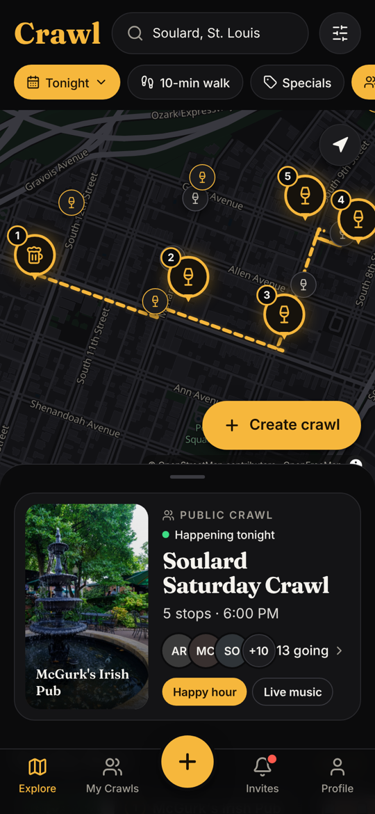
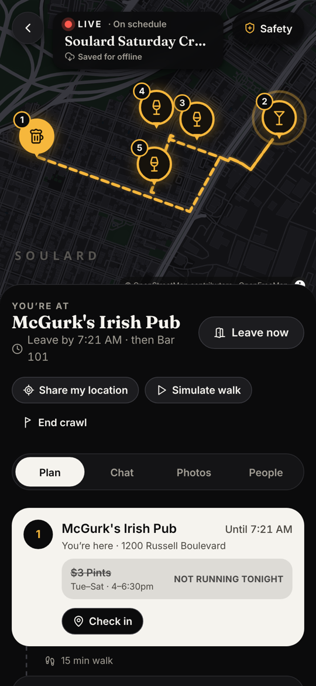
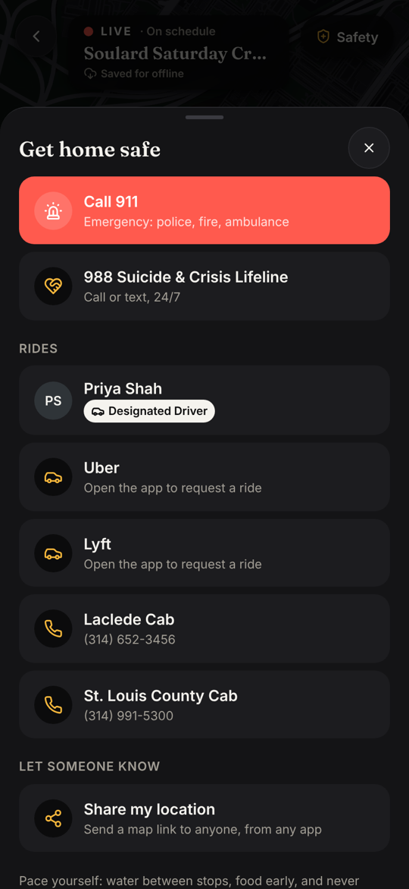
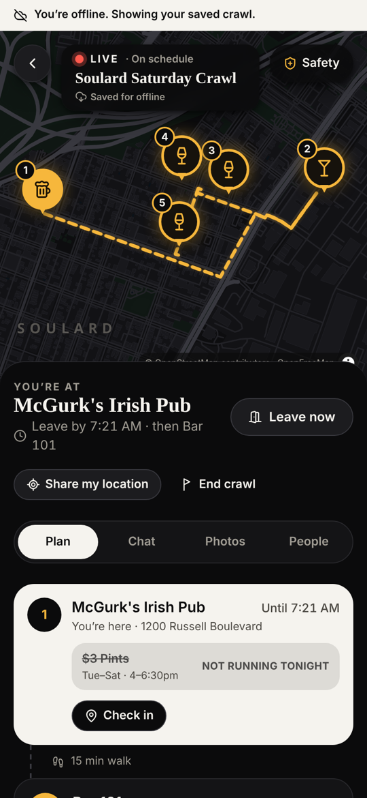
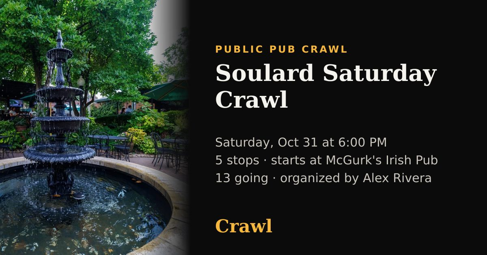

# Crawl

Plan a pub crawl on open-source maps, invite your crew, and run it live. It launches in **St. Louis**, with **Soulard** as the default neighborhood.

- **Build a crawl.** Pick bars on an OpenStreetMap map, set the date, start time and how long you stay at each stop, and add drink specials.
- **Optimized walking route.** The app solves the best stop order from walking times, specials' time windows and venue hours. You can ask for *quieter* or *scenic* streets, or set a cap on any single walk. Claude turns free-text wishes into solver weights and explains the result. The organizer reviews the result against their own order and approves it.
- **Live specials.** During the crawl, the app re-projects arrival times as the group moves. A special that is live at the next stop gets a highlight card. If the group will arrive after a special ends, everyone gets an alert. The organizer also gets one-tap fixes: leave earlier, swap the next stop, or skip a stop.
- **Invites.** Crawls are public or private. Invite links can carry a use limit and an expiry, and you can also invite people directly. Attendees RSVP as **Going**, **Maybe** or **Can't make it**.
- **Roles.** The organizer can make members co-hosts and can give out crew badges: **Designated Driver**, **Navigator** and **Photographer**.
- **Shared photo album per crawl.** Photos upload directly to storage through presigned URLs. The server makes thumbnails and runs a moderation check. The album has a Newest / By bar view, a swipe viewer, reporting and auto-hide, and a .zip download once the crawl ends.
- **Group chat** for each crawl, in real time.
- **Visited History.** Check in at each stop during the crawl. Once the crawl ends, those bars show up as a completed list in your profile.
- **Offline mode.** Opening a live crawl (or one starting within a day) saves the itinerary, specials, chat and the map tiles for that area. Chat messages and check-ins made without signal are queued and sent automatically when the connection returns.
- **Push notifications** (Web Push): a nudge to people who RSVP'd Maybe the day before, a heads-up an hour before start, "group is heading to X" when the group leaves a stop, live specials alerts, and a home-safe check after the crawl.
- **Safety card.** Call 911, the 988 Lifeline, the crawl's Designated Driver, Uber or Lyft, and two local cab companies (numbers checked against each company's own site). You can also share your location as a map link. After the crawl, members tap **I'm home**, and the organizer sees who hasn't confirmed yet.
- **Link previews.** Invite and public crawl links show a title, date, first stop and a generated share image in iMessage, WhatsApp, Slack and similar apps.

| Explore | Live crawl | Safety | Offline |
| --- | --- | --- | --- |
|  |  |  |  |

Invite links preview with a generated share card:



## Quick start (local)

Requirements: Node 22+, Postgres 14+ (PostGIS optional), Redis 6+.

```bash
npm install
cp apps/api/.env.example apps/api/.env      # set DATABASE_URL / REDIS_URL if not default
npm run db:seed                              # migrate + seed St. Louis / Soulard + dev users
npm run dev                                  # API :4000, web :5173
```

Open http://localhost:5173 and use **Development · sign in as → Alex Rivera**. Alex organizes *Soulard Saturday Crawl*: hit **Start crawl**, then **Simulate walk** to watch the live engine move the group, fire highlights and flag misses.

Or run everything in containers:

```bash
docker compose up --build        # http://localhost:8080
docker compose run --rm api node dist/db/seed.js
```

## Workspace

```
packages/core   Shared TypeScript domain logic (no I/O)
                  solver.ts   Held–Karp TSP-TW + local search, spec cost function
                  live.ts     ETA projection, pace learning, special states, one-tap fixes
                  time.ts     Recurring special windows (cross-midnight, weekdays in crawl TZ, DST)
                  api.ts      Wire DTOs + Socket.IO event contracts shared by API and clients
apps/api        Fastify + Socket.IO + Postgres + BullMQ
                  services/optimizer.ts  matrix → penalties → solve → legs → LLM explanation → approve
                  services/live.ts       geofence arrival/departure, engine ticks, alerts, walk simulator
                  services/routing.ts    Valhalla → OSRM foot → estimate, cached in Postgres
                  services/llm.ts        Claude: preference → weights, route explanation (template fallback)
                  services/queue.ts      route-optimize + photo-process workers (sharp thumbnails)
                  scripts/import-osm.ts  Overpass venue + road/green sync per neighborhood
apps/web        React + Vite + MapLibre GL PWA (mobile-first)
                  features/LiveCrawlView.tsx, PhotoGallery.tsx, People.tsx, Chat.tsx, RoutePanel.tsx …
```

## Scripts

| Command | What it does |
| --- | --- |
| `npm run dev` | API (tsx watch) + web (Vite) |
| `npm test` | Core unit tests + API integration tests (needs Postgres `crawl_test` + Redis) |
| `npm run typecheck` | All packages |
| `npm run build` | Production builds |
| `npm run db:seed` | **Resets** dev data |
| `npm run venues:import -- soulard` | Refresh a neighborhood from OpenStreetMap (set `OVERPASS_URL` to your own instance) |

## Configuration

See `apps/api/.env.example`. The most important settings:

- `ANTHROPIC_API_KEY`: turns on Claude (`claude-opus-5-5` at low effort, with server-side refusal fallback) for preference parsing and route explanations. Without a key, the app uses deterministic template explanations and keyword-based preference parsing.
- `VALHALLA_URL`: a self-hosted Valhalla instance gives preference-aware pedestrian costing. `docker compose --profile routing up valhalla` builds tiles for Missouri. Without it, the app uses the OSRM foot profile and, offline, a straight-line × street-grid estimate.
- `VITE_TILES_URL` / `VITE_GLYPHS_URL` (web): an OpenMapTiles-schema vector source. The default is OpenFreeMap; point it at self-hosted tiles for production.

## Data and attribution

**Venue photos** (`apps/api/data/venue-images/`): 10 Soulard bars have photos taken from each venue's **own website** and credited in-app ("Photo: McGurk's"). No openly licensed photos of these bars existed on Wikimedia Commons. **Get each venue's permission before launch, or replace the photos** through a venue-claim upload. `research-manifest.json` records the source page for every photo and why the other 11 bars have none. The other bars show illustrated art. Two venues are flagged `reported_closed` and hidden from discovery until someone verifies them: Llywelyn's Soulard and Bar 101. Re-run `npx tsx src/scripts/import-venue-images.ts <manifest> <dir>` to refresh.

Venue locations, hours, roads and parks come from © OpenStreetMap contributors (ODbL). Display names, tags and price levels in the seed are app-side curation. They are stored as overrides and never written back to OSM. **The seeded drink specials are sample data for development**: they are labeled crowd-reported and are not verified offers from those venues.

See [docs/ARCHITECTURE.md](docs/ARCHITECTURE.md) for design notes and where this build differs from the technical spec.
